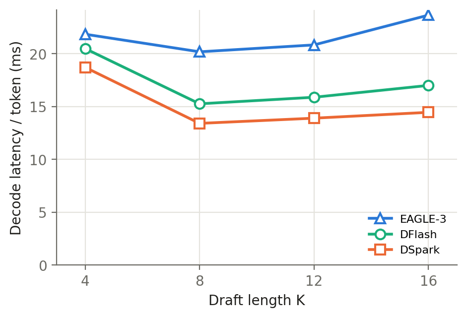
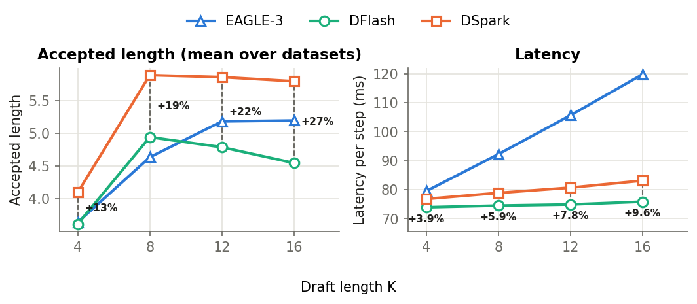

# Scaling Draft Length in Speculative Decoding: Acceptance-Latency Trade-offs Across EAGLE-3, DFlash, and DSpark

  <a href="#about">About</a> •
  <a href="#main-contributions">Main Contributions</a> •
  <a href="#reproducing">Reproducing</a> •
  <a href="#links">Links</a> •
  <a href="#license">License</a>

## About

A research project built on a fork of [deepseek-ai/DeepSpec](https://github.com/deepseek-ai/DeepSpec). We compare three speculative decoding methods - EAGLE-3, DFlash and DSpark - against the autoregressive baseline under a common setup: Qwen3-4B target, released DeepSpec drafters (trained with 7 draft tokens), GSM8K / Math500 / AIME25, draft length `K ∈ {4, 7, 8, 12, 16}`, batch size 1 on a single RTX 3090.

Main question: *which speculative decoding approach provides the best trade-off between accepted length and latency as the draft length increases?*

Main report: [report.pdf](report.pdf)

## Main Contributions

  

- **DSpark has the best acceptance-latency trade-off.** It is the fastest method at every K and on every dataset: 13.4 ms/token at K = 8, 12% less than DFlash and 34% less than EAGLE-3 (4.3× speedup over AR with ~34% more memory).
- **No universal K.** For all methods the latency optimum is K = 8, next to the trained length, but the optimal K varies with task difficulty even within the math domain.

  

- **Reproduction at the trained length (K = 7).** The ranking DSpark > DFlash > EAGLE-3 is reproduced on all three datasets. DSpark improves accepted length by 26.0% over EAGLE-3 and 16.6% over DFlash (paper: 22.3% and 16.2%).
- **Stronger degradation beyond the training horizon.** Unlike the DSpark paper, accepted length does not keep growing up to K = 16: DSpark saturates after K = 8 and DFlash declines.
- **Larger DSpark overhead at batch size 1.** DSpark's per-step overhead over DFlash grows from 3.9% (K = 4) to 9.6% (K = 16), versus 0.2-1.3% reported at batch size 128.

## Reproducing

See [experiments/README.md](experiments/README.md) for environment setup, sweep configs, the run command and output format.

## Links

- Notebook with data analysis: [experiments/notebooks/report.ipynb](experiments/notebooks/report.ipynb)
- Experiments sweep config: [experiments/configs/qwen3_4b_main.py](experiments/configs/qwen3_4b_main.py)
- Collected raw data: [Yandex Disc Link](https://disk.360.yandex.ru/d/jtVrrZIKN4IrWw)
- Paper source: [report.tex](report.tex)
- Original DeepSpec README: [README_DeepSpec.md](README_DeepSpec.md)

DeepSpec algorithms are left untouched; all experiment code lives in [experiments/](experiments/).

## License

